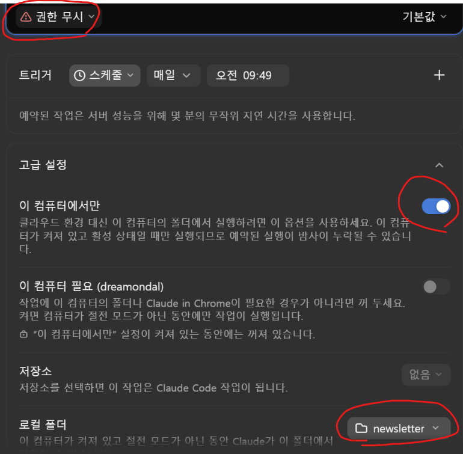

# 뉴스레터

원하는 주제의 최근 24시간 뉴스를 모아 메일로 보내는 뉴스레터예요.    
먼저 아래 변수값을 결정하고 진행하세요.    
- {SUBJECT}: 뉴스레터 주제
- {SUBJECT_ID}: 주제를 의미하는 영문 소문자명    

## newsletter 레포지토리 Fork(복사)하기    
- GitHub(https://github.com)에 로그인. 계정이 없으면 먼저 회원가입부터 해요.           
- `https://github.com/unicorn-svc/newsletter`으로 접근해요.     
- 상단 우측의 'Fork' 버튼을 클릭해요.      
       
- 'Create fork'를 클릭하여 복사해요.     
       

※ Organization 만들어 Fork하기       
- 'Owner'는 본인의 Organization이고, 기본으로 본인의 Git ID입니다.     
- Organization은 저장소를 목적에 맞게 그룹핑한겁니다.    
- 본인만의 Organization을 만들어 Fork하고 싶으면 [Organization 만들기](references/github-org.md)를 참조하세요.   
    
## 본인의 newsletter 레포지토리 클론하기    
레포지토리를 다운로드할 상위 디렉토리를 만듭니다.     
```
cd ~
mkdir workspace
```

newsletter 레포지토리를 클론합니다.    
```
cd workspace
```

git clone https://github.com/{본인 Organization}/newsletter.git    
예시)  
```
git clone https://github.com/hiondal/newsletter.git
```
  
---
  
## 메일 발송을 위한 인증정보 생성하기 
1.https://myaccount.google.com/security 접속하여 2단계 인증을 활성화합니다. (이미 돼 있으면 skip)   
2.https://myaccount.google.com/apppasswords 접속합니다.    
- 앱 이름을 적절하게 입력하고 '만들기'를 클릭   
- 생성된 16자리 코드 복사   

3.`.env`파일에 아래와 같이 SMTP설정을 합니다.       
`.env`파일이 없으면 프로젝트 루트 디렉토리(`~/workspace/newsletter`) 밑에 생성하세요.   
SMTP_USER는 인증정보 생성 시 로그인한 gmail을 입력하고 SMTP_PASSWORD에 인증코드 16자리를 붙여넣습니다.       
```
SMTP_SERVER=smtp.gmail.com
SMTP_PORT=587
SMTP_USER=hiondal@gmail.com
SMTP_PASSWORD=wgnr aaaa eeee ffff
```

---
  
## 메일 수신자 지정하기
`.env`파일 안에 'RECIPIENTS'와 'RECIPIENTS_{SUBJECT_ID 대문자}'키를 만듭니다.    
값은 큰 따옴표안에 엔터로 구분하여 지정합니다.    
'{SUBJECT_ID 대문자}'는 프롬프트의 '{SUBJECT_ID}'에 지정한 값과 동일해야 하며 대문자여야 합니다.     
모든 주제에 공통으로 받을 주소는 'RECIPIENTS'에 넣습니다. 'RECIPIENTS'는 항상 포함되고, 주제별 주소가 여기에 더해집니다. 겹치는 주소에는 한 번만 보냅니다.    
```
# recipients
RECIPIENTS="
hiondal@gmail.com
"
RECIPIENTS_AI="
happycloudtek@unicorn.kubepia.com
"
```
  
## 내 주제로 뉴스레터 설정하기

### 템플릿을 주제별 파일로 복사해요.   
탐색기, vscode, 터미널 등 편한 툴로 템플릿을 복사하여 본인의 프롬프트 파일을 만들어요.     
아래는 터미널에서 수행하는 예시에요.     
```bash
cp prompts/routine-template.md prompts/routine-{SUBJECT_ID}.md
```

복사한 파일의 `[변수]`에서 `{SUBJECT}`(주제, 예: 반도체). `{SUBJECT_ID}`(주제를 나타내는 영문소문자), `{OBJECT}`(뉴스레터를 받는 목적)를 정해요.
수집·정리·발송 절차는 모든 주제가 같이 쓰는 `prompts/routine-common.md`에 있고, 주제별 파일은 변수만 정해서 그 파일을 참조해요. 그래서 절차를 고칠 때는 `routine-common.md` 하나만 고치면 돼요.
아래는 예시에요.      
```
[변수]
- {SUBJECT}: 게임
- {SUBJECT_ID}: game
- {OBJECT}: 게임 시장 트렌드를 파악하여 새로운 게임 기획에 참조하고 싶음

[수행]
- `prompts/routine-common.md` 를 읽고, 그 안의 {SUBJECT}·{SUBJECT_ID}·{OBJECT} 를 위 [변수] 값으로 바꿔서 그대로 수행함
```
이 주제에만 적용할 규칙이 있으면 `[추가 제약조건]`에 적어요(예: GraphRAG의 "최대 15개까지의 뉴스만 선정"). 필요 없으면 그 절은 지워요.
  
### 스케줄 작업을 등록합니다.   
```
prompts/routine-{주제}.md를 수행하세요.
```
Claude Code는 좌측 메뉴에서 '예약'누르고 우측에서 '새작업 > 직접설정'을 클릭합니다.     
Codex는 가장 좌측 패널에서 세번째 '예약' 아이콘을 클릭하고 '새 작업'을 선택하여 스케쥴 작업을 작성합니다.         
모델과 Effort(추론수준)는 적절히 지정하세요.     
  
#### Claude Code        
            
             

※ '이 컴퓨터에서만' 활성화 후에 작업모드가 '수동'으로 전환됩니다. **다시 '권한 무시'로 변경**하세요.     
  
#### Codex     
프로젝트부터 만듭니다.    
       
  
스케쥴 예약을 등록합니다.    
    
      
  

### 최초 한번 실행합니다.       
### Claude Code        
- 상단 아이콘 중 '지금 실행하기' 아이콘을 눌러요.     
  그리고 좌측 '기록'에서 수행한 작업을 선택해요.         
         

- 추천한 뉴스 사이트를 검토하고 승인하세요     

### Codex     
- 등록된 스케쥴의 우측 '...'을 클릭하고 '지금실행'을 수행하세요.       
              
- 추천한 뉴스 사이트를 검토하고 승인하세요.      
  
※ 고른 사이트는 `AGENTS.md`의 `## 뉴스사이트`에 기록되고, 다음 실행부터 그대로 써요.

---

## 월간 트렌드 보고서 생성
프롬프트에 아래와 같이 입력하세요.   
```
{주제} {월} 트렌드 보고서 생성해요.
```
예시:    
```
AI 10월 트렌드 보고서 생성해요. 
```
  
결과는 `trends/{SUBJECT}/{YYYYMM}` 폴더에 생성되고,    
`.env`의 'RECIPIENTS'와 'RECIPIENTS_{주제}'에 정의한 email로 발송되요.      

URL 형식: https://htmlpreview.github.io/?https://github.com/{ORG}/{REPO}/blob/main/trends/{SUBJECT}/{YYYYMM}/index.html   
예시) AI 2026년 10월 트렌드 보고서: https://htmlpreview.github.io/?https://github.com/unicorn-svc/newsletter/blob/main/trends/ai/202610/index.html  

---

## 월간 트렌드 보고서 생성 예약   
스케쥴 작업으로 매월 1일에 이전 달의 월간 트렌드 보고서 생성을 합니다.    
여러개 주제의 트렌드 보고서를 한꺼번에 생성하려면 주제를 여러개 지정하면 되요.    
```
이전 달의 {주제} 트렌드 보고서 생성
```
예시:    
```
이전 달의 AI, 로봇, 온톨로지, 하네스엔지니어링에 대한 트렌드 보고서 생성
```
   
---

## 분류체계 변경법

분류체계 카테고리는 자동으로 생성됩니다.    
변경하고 실으면 `data/{SUBJECT_ID}/categories.json`을 수정하세요.    

```json
{
  "palette": ["#db2777", "#0891b2"],
  "categories": [
    {"id": "genai", "emoji": "✨", "label": "생성AI", "color": "#7c3aed"}
  ]
}
```

- **이름·이모지·색 바꾸기**: 해당 항목의 `label`, `emoji`, `color`를 고쳐요. 다음 호부터 반영돼요.
- **카테고리 추가**: 항목을 직접 추가하거나 그냥 두면 돼요. 기존 카테고리에 맞지 않는 기사가 나오면 실행 중에 새 카테고리가 자동으로 추가돼요.
- **표시 순서**: `categories` 배열 순서대로 뉴스레터에 나와요.
- **자동 배정 색**: 새 카테고리 색은 `palette`에서 순서대로 골라요.
- **처음부터 다시 만들기**: 파일을 지우면 다음 호에서 기사에 맞게 새로 만들어요.
- **주의**: `id`를 바꾸거나 지우면, 그 `id`를 쓰는 지난 호 데이터를 다시 렌더링할 때 오류가 나요. 이름만 바꿀 때는 `id`를 그대로 두세요.

---

## 참고: 뉴스레터 발송에 필요한 파일  

| 파일 | 설명 |
|---|---|
| `prompts/routine-{SUBJECT_ID}.md` | 스케줄 작업이 수행하는 주제별 프롬프트 (변수와 추가 제약조건만) |
| `prompts/routine-common.md` | 모든 주제가 같이 쓰는 수집·정리·발송 절차 |
| `.env` | SMTP 설정과 수신자. 수신자는 'RECIPIENTS_{SUBJECT_ID 대문자}' 형식으로 작성 |
| `data/{SUBJECT_ID}/categories.json` | 카테고리 목록. 첫 호를 만들 때 자동 생성되고, 새 카테고리가 생기면 자동으로 쌓여요 |
| `templates/newsletter.html` | 뉴스레터 HTML 골격과 스타일 |
| `scripts/generate_newsletter.py` | 데이터 JSON을 HTML로 렌더링하고 `--send`로 메일 발송 |
| `scripts/email_sender.py` | SMTP 메일 발송 |
| `scripts/requirements.txt` | 위 프로그램들이 쓰는 패키지. 저장소 루트에서 `pip install -r scripts/requirements.txt` |
| `AGENTS.md` | 주제별 뉴스 사이트 목록 (`## 뉴스사이트`) |

결과물은 `data/{SUBJECT_ID}/YYYYMMDD_HHMM.json`(기사 데이터)과 `newsletters/{SUBJECT_ID}/YYYYMMDD_HHMM.html`(뉴스레터)에 저장돼요.

